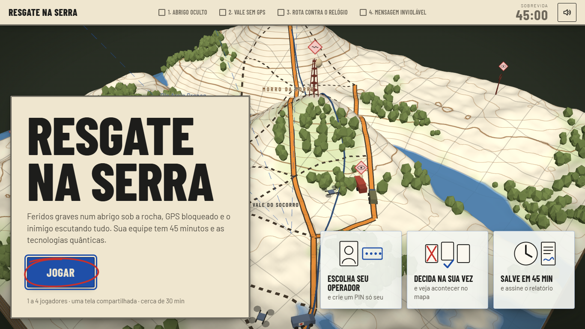
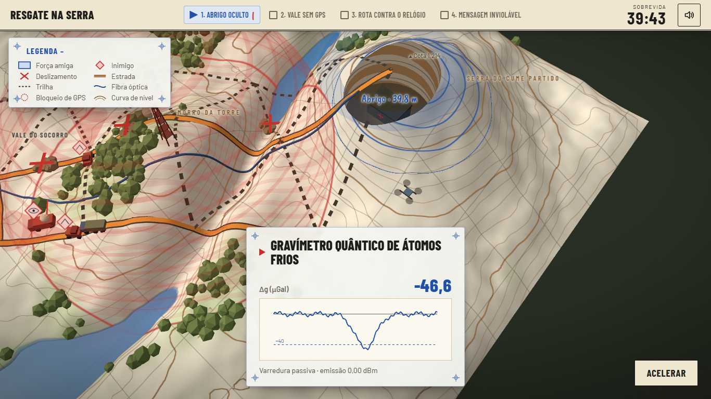
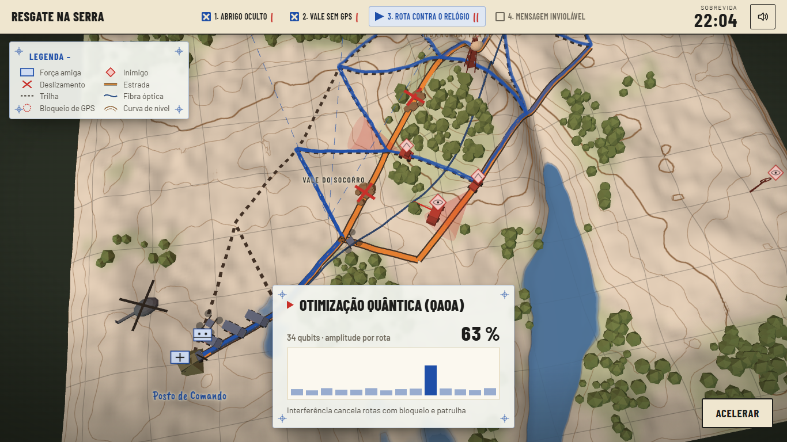
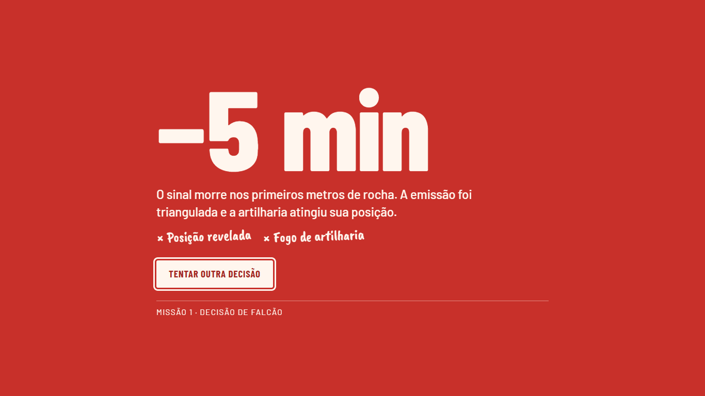

<div align="center">

# 🗺️ Resgate na Serra
### Sala de Crise Quântica · jogo tático no navegador

**Feridos graves sob 40 m de rocha. GPS bloqueado. Inimigo escutando tudo.**
**Sua equipe tem 45 minutos e as tecnologias quânticas.**

<br>

<a href="https://irlansouza93.github.io/simulador-virtual-crises-taticas/">
  
</a>

<br><br>

[](https://irlansouza93.github.io/simulador-virtual-crises-taticas/)
[](https://github.com/irlansouza93/simulador-virtual-crises-taticas/actions/workflows/ci.yml)


<br>



</div>

---

## 🎓 Sobre o projeto

**Resgate na Serra** foi criado em parceria com a **UVPR (Universidade Virtual do Paraná)**, no **Ecossistema CÓRTEX** (UVPR / UEPG / CTEx), para o curso **Princípios de Tecnologias Quânticas · Módulo 2: Aplicações Quânticas 2.0**.

O objetivo é **tirar o conteúdo do curso do papel**: em vez de ler sobre gravimetria quântica, navegação inercial atômica, otimização com qubits e distribuição quântica de chaves, a turma **decide sob pressão e vê cada decisão acontecer** num mapa 3D. A tecnologia clássica falha na frente de todos; a quântica resolve. A diferença física fica impossível de esquecer.

> A atividade é feita em equipe, numa tela compartilhada (por exemplo, no Google Meet). Cada aluno tem a sua vez, o seu PIN e as suas próprias palavras no relatório final.

---

## 🎮 Como jogar, em 3 passos

| | |
|:---:|---|
| **1 · Escolha seu operador** | Cada jogador escolhe um dos 8 personagens, digita o próprio nome e cria um PIN de 4 números. |
| **2 · Decida na sua vez** | Só o dono da missão assume o controle, com o próprio PIN. Escolha uma tecnologia e veja o resultado no mapa. Errou? O card vermelho mostra o custo, e o relógio desconta. |
| **3 · Salve em 45 min e assine** | No fim, cada um escreve e assina o próprio parecer. Baixe o relatório em PDF e entregue no AVA. |

---

## 🧭 As quatro missões

<table>
<tr>
<td width="50%"></td>
<td width="50%"></td>
</tr>
</table>

| # | Missão | Função | O desafio | O que você vê no mapa |
|:-:|---|---|---|---|
| 1 | **Abrigo oculto** | Reconhecimento | Abrigo sob 40 m de rocha; qualquer emissão é triangulada | O radar é localizado e atingido pela artilharia; o **gravímetro de átomos frios** abre um corte na serra e revela o abrigo (−44,2 μGal) |
| 2 | **Vale sem GPS** | Navegação | A torre inimiga bloqueia o satélite | A deriva da navegação mecânica joga a viatura no barranco; o **inercial quântico** atravessa o vale com erro < 1 m |
| 3 | **Rota contra o relógio** | Logística | Deslizamentos e patrulhas sorteados a cada partida | O supercomputador conta **bilhões de combinações reais**; o **QAOA** colapsa a superposição na melhor rota e o comboio parte |
| 4 | **Mensagem inviolável** | Guerra Eletrônica | Fibra grampeada: *Harvest Now, Decrypt Later* | Os pacotes são copiados para o cofre inimigo; com **QKD (BB84)**, o espião é denunciado pela QBER |

<div align="center">

<br><sub>Cada decisão errada mostra o que deu errado e custa minutos de sobrevida.</sub>
</div>

---

## ✨ Destaques

- **🗺️ Mundo 3D de carta topográfica:** relevo com curvas de nível, quadrícula UTM, rio, florestas e símbolos táticos (APP-6). Avião, helicóptero, drones, comboio e patrulhas se movem pela malha viária.
- **⏱️ Simulação de verdade:** 45 minutos de janela clínica. A rota da Missão 3 é calculada num grafo real (Dijkstra), e o tempo de viagem sai do relógio. Conforme o tempo cai, o mapa escurece até a luz vermelha de leitura noturna.
- **🔐 Antifraude para tela compartilhada:**
  - PIN guardado só como hash PBKDF2 com sal, sem PIN mestre;
  - PINs fracos ou repetidos são recusados, e 3 erros bloqueiam o jogador por 30 s;
  - toda decisão e todo texto entram numa cadeia SHA-256, e o relatório denuncia qualquer edição feita fora do jogo.
- **✍️ Relatório humano:** nada é escrito pelo sistema em nome do aluno. Notas de campo, pareceres individuais e a conclusão da equipe são digitados e assinados por quem escreveu.
- **📱 Funciona em qualquer tela:** notebook, projetor ou celular, com mouse, toque ou teclado.

> **Limite honesto:** tudo roda no navegador, sem servidor. O antifraude impede que um colega decida ou escreva no lugar do outro durante a partida. Não protege contra quem manipula as ferramentas de desenvolvedor do navegador.

---

## 🛠️ Tecnologia

| Camada | Ferramenta |
|---|---|
| Cena 3D | Three.js 0.160 (WebGL, shaders próprios para o relevo) |
| Interface | HTML, CSS e JavaScript puros, sem etapa de build |
| Relatório | jsPDF, com as fontes do jogo embutidas |
| Som | Web Audio API (som gerado no código, sem arquivos) |
| Tipografia | Barlow, Barlow Condensed e Caveat Brush (Google Fonts, licença OFL) |
| Qualidade | Testes com `node --test` e GitHub Actions a cada push |
| Publicação | GitHub Pages |

### Rodar no seu computador

```bash
git clone https://github.com/irlansouza93/simulador-virtual-crises-taticas.git
cd simulador-virtual-crises-taticas
python -m http.server 8000
```

Abra http://localhost:8000. Para os testes (Node 18 ou mais recente): `npm test`.

<details>
<summary><strong>Estrutura do código</strong></summary>

```
index.html          telas do jogo
css/style.css       visual da carta topográfica
js/scene.js         cena 3D e animações de cada decisão
js/routing.js       malha viária, sorteio de deslizamentos/patrulhas, Dijkstra
js/integrity.js     PIN, bloqueio, cadeia SHA-256 e auditoria
js/missions.js      conteúdo das missões
js/instruments.js   instrumentos ao vivo (gravímetro, QBER, qubits)
js/report.js        relatório e PDF
tests/              testes automatizados
```
</details>

---

## 📚 Referências

- UVPR / CTEx. *Princípios de Tecnologias Quânticas: Aplicações Quânticas 2.0*. Ecossistema CÓRTEX, 2026.
- CSIS. *Quantum Sensing and the Future of Warfare: Five Essential Reforms to Stay Competitive*. Washington, D.C., 2023.

---

<div align="center">

### 👨‍💻 Desenvolvido por

**Irlan Souza**
Desenvolvedor Fullstack

[](https://github.com/irlansouza93)

<br>

<a href="https://irlansouza93.github.io/simulador-virtual-crises-taticas/">
  
</a>

<sub>Projeto educacional em parceria com a UVPR · Ecossistema CÓRTEX · UVPR / UEPG / CTEx</sub>

</div>
